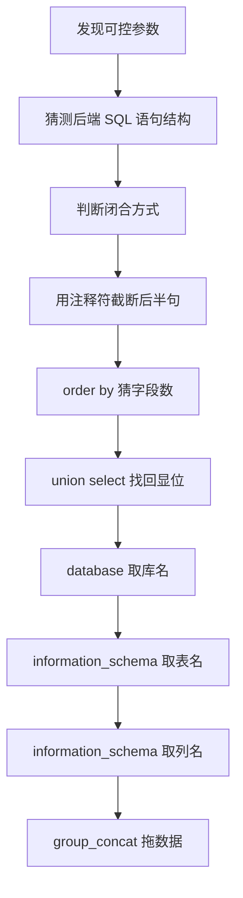

# Renewal

> SQL 注入学习笔记：原理、闭合判定、联合查询注入、信息收集、sqlmap 实战与防御。

本仓库是把手工测试的完整思路按「**先判断、再回显、后取数**」的顺序整理成一份可复习的笔记。
所有示例基于自建靶场（sqli-labs 的 `security` 库），仅用于理解原理。

> ## ⚠️ 免责声明
> 本仓库内容**仅用于授权环境下的学习与安全测试**（自建靶场、明确授权的渗透测试项目）。
> 未经授权对他人系统进行扫描、探测或攻击，在多数国家和地区都属于违法行为，后果自负。

---

## 目录

| 章节 | 内容 | 关键点 |
| --- | --- | --- |
| [01 基本原理](docs/01-基本原理.md) | 注入是怎么产生的 | 输入拼接、语义改变 |
| [02 判断闭合方式](docs/02-判断闭合方式.md) | 猜出参数被什么符号包裹 | 引号、括号、转义符 `\`、注释符 |
| [03 联合查询注入](docs/03-联合查询注入.md) | 用 `union select` 把数据打到页面上 | `order by` 猜字段、找回显位 |
| [04 信息收集](docs/04-信息收集.md) | 库名 → 表名 → 列名 → 拖库 | `information_schema`、`group_concat` |
| [05 POST 注入](docs/05-POST注入.md) | 表单参数怎么打 | `--data`、`*` 指定注入点 |
| [06 sqlmap 使用](docs/06-sqlmap使用.md) | 常用命令与 `--technique` 详解 | `--dbs`、`--dump`、B/E/T/U |
| [07 环境组合与防御](docs/07-环境组合与防御.md) | 常见架构指纹与修复方案 | 参数化查询、最小权限 |

---

## 手工注入的通用流程



## 仓库结构

```
Renewal/
├── README.md
├── docs/
│   ├── 01-基本原理.md
│   ├── 02-判断闭合方式.md
│   ├── 03-联合查询注入.md
│   ├── 04-信息收集.md
│   ├── 05-POST注入.md
│   ├── 06-sqlmap使用.md
│   └── 07-环境组合与防御.md
├── images/          # 截图、示意图放这里，用相对路径引用
├── .gitignore
└── LICENSE
```

## 使用建议

1. 先看 01、02 两章，把「闭合」这件事想明白，后面的注入都是它的延伸。
2. 03、04 章要对着靶场一条条敲，看回显变化，比背语句有效。
3. 06 章的命令抄下来跑一遍，重点理解 `--technique` 的选择逻辑。

## 许可

文档内容采用 [CC BY 4.0](https://creativecommons.org/licenses/by/4.0/deed.zh) 许可，文中代码片段采用 MIT 许可。
