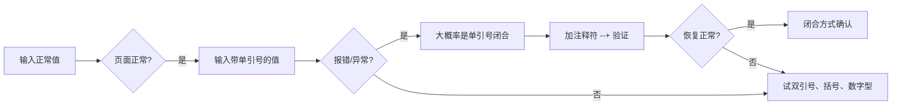

# 01 基本原理

## 1.1 注入是怎么产生的

后端把「用户输入」直接拼进 SQL 语句里，输入的内容就变成了**SQL 语法的一部分**。只要输入能改变原语句的语义，就是注入。

典型的有漏洞代码：

```php
$id  = $_GET['id'];
$sql = "select id, username, password from table1 where id='$id' limit 0,1";
```

正常请求 `id=4` 时，拼出来的语句是：

```sql
select id, username, password from table1 where id='4' limit 0,1
```

输入 `id=4' --+` 时，拼出来变成：

```sql
select id, username, password from table1 where id='4' -- ' limit 0,1
```

- 前面的 `'` 把原语句里的第一个单引号**提前闭合**了；
- `--+` 把后面的内容**注释掉**，让它不参与语法检查。

语句依然合法，但语义已经变了。这就是最基本的注入模型。

## 1.2 三个必要条件

| 条件 | 说明 |
| --- | --- |
| 输入可控 | 参数值来自用户（GET、POST、Cookie、Header 都可能） |
| 拼接进 SQL | 字符串拼接，而不是参数化占位符 |
| 处理不当 | 没有转义、没有类型强转、没有白名单 |

## 1.3 第一步：猜语句

手工注入的起点不是直接打 payload，而是**先猜后端的语句长什么样**。

比如常见的一句：

```sql
select username, password from table1 where id = "4" limit 1,3;
```

需要猜清楚三件事：

1. 有哪些**字段**被 `select` 出来（决定后面 `union select` 要凑几个）；
2. `where` 后面的参数是**怎么包裹**的（单引号？双引号？带括号？数字型？）；
3. 语句后面还跟了什么（`limit`、`order by` 等，决定注释符要截断多长）。

猜语句靠的是**回显差异**：正常、报错、空白、只返回一半，这几种现象分别对应不同的闭合方式。

## 1.4 判断思路



下一章展开「闭合」的判断细节。
